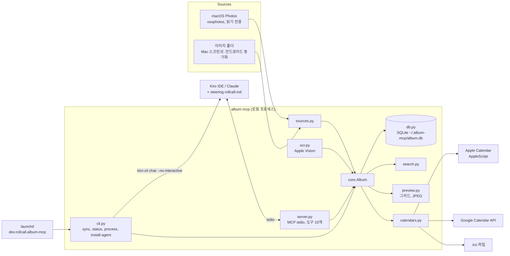

# Design Document: Rollcall (album-mcp)

> 이 설계 문서는 구현을 마친 뒤 실제 코드를 기준으로 작성했습니다. 요구사항과 다르게 구현한 부분은 `requirements.md`에 **[구현 변경]**, 구현하지 않은 부분은 **[이번 범위 제외]**로 표시했습니다.

## Overview

Rollcall은 사용자의 스크린샷과 사진을 AI 어시스턴트가 쓸 수 있게 해 주는 로컬 MCP 서버입니다. 서버는 **보는 일**(파일 찾기, OCR, 썸네일, 저장, 검색, 캘린더 쓰기)만 하고, **이해하는 일**(분류, 요약, 태그, 날짜 해석)은 서버를 호출하는 AI(Kiro)가 합니다. 서버 안에는 LLM이 없습니다.

핵심 결정:

| 결정 | 선택 | 이유 |
|---|---|---|
| 의미 이해 | 호출하는 AI가 OCR 텍스트와 썸네일을 보고 판단 | 외부 비전 API나 임베딩 모델 없이도 정확하고, 사진이 Mac 밖으로 나가지 않음 |
| 검색 | 필드 가중치 키워드 검색 + AI의 질의 확장 + 썸네일로 최종 확인 | 분류 때 AI가 한·영 태그를 붙여 두므로 벡터 DB 없이 충분함 |
| OCR | Apple Vision을 pyobjc로 직접 호출 (ko-KR, en-US) | ocrmac은 한국어를 허용하지 않음. Vision은 온디바이스·무료 |
| Photos 접근 | osxphotos (Photos.sqlite 사본을 읽음) | 원본 라이브러리에 쓰지 않음, Apple 라벨·iCloud 미리보기 경로 제공 |
| MCP SDK | `mcp` 2.x의 `MCPServer` | 설치된 2.3.0에서 FastMCP가 MCPServer로 바뀜 |
| 자동 실행 | launchd(WatchPaths + StartInterval) → `album-mcp process` → Kiro CLI 헤드리스 | 캡쳐 순간에만 깨어나고, 판단은 같은 steering을 쓰는 Kiro가 함 |

## Architecture



`core.Album`이 모든 로직을 가지고, `server.py`(MCP)와 `cli.py`(터미널, launchd)는 얇은 진입점입니다. 테스트도 `Album`을 직접 부릅니다.

## Components and Interfaces

### sources.py: 캡쳐 소스

```python
class Source(Protocol):
    name: str
    def items(self, since: datetime | None) -> Iterator[Item]: ...
```

| 소스 | id | 생성 시각 | 비고 |
|---|---|---|---|
| `PhotosSource` | `photos:<uuid>` | Photos의 촬영 시각 (로컬, naive) | `p.screenshot`인 이미지만. 원본이 iCloud에만 있으면 `path_derivatives` 중 존재하는 첫 파일(가장 큰 미리보기) 사용 |
| `FolderSource` | `folder:<sha1(절대경로)[:16]>` | 파일 mtime | png, jpg, jpeg, heic, webp. 하위 폴더 포함. `ALBUM_MCP_FOLDERS`(`:` 구분) |

`PhotosSource`는 PhotosDB와 이미지 목록을 프로세스당 한 번만 읽어 메모리에 둡니다 (실측 42,147장 7.6초). 오래 켜진 서버도 새 사진을 보도록 5분(`ALBUM_MCP_PHOTOS_REFRESH`)이 지나면 다음 호출 때 다시 읽습니다 (tasks 21.1).

Photos 라이브러리를 열 수 없으면(전체 디스크 접근 권한 없음) `SourceUnavailable`을 던지고, `Album.sync`는 이를 `errors`에 담아 돌려준 뒤 나머지 소스로 계속 진행합니다.

### ocr.py: 온디바이스 OCR

`ocr_image(path) -> str`. `VNRecognizeTextRequest`(accurate, 언어 보정 켬, `["ko-KR", "en-US"]`)를 실행하고, 관측 결과를 위→아래, 왼쪽→오른쪽으로 정렬해 줄바꿈으로 합칩니다. 실패하면 로그를 남기고 `""`를 반환합니다. 실측 장당 0.03–1.3초.

### db.py: 로컬 저장소

```sql
captures(id PK, source, path, filename, created_at, width, height, size_bytes,
         ocr_text, labels JSON, kind NULL=미분류, summary, tags JSON, filed_at)
events(id PK, capture_id, backend, event_ref, title, start, end, place, created_at,
       UNIQUE(capture_id, backend, start))
state(key PK, value)          -- watermark, last_sync
```

- 스키마 버전은 `PRAGMA user_version`. `MIGRATIONS` 리스트의 i번째가 버전 i→i+1.
- 마이그레이션 전에 기존 DB를 `album.v{n}.bak`으로 복사하고, 실패하면 복원한 뒤 예외를 올립니다.
- `upsert_capture`는 경로와 라벨만 갱신하고 분류는 덮어쓰지 않습니다.
- `file()`이 kind(4종)와 summary 길이(≤200)를 검증합니다.

### search.py: 검색 순위

1. query를 공백·`,`·`|`·`/`로 나눠 소문자화하고 공백을 없앤 검색어 목록을 만듭니다. 공백 제거는 한국어 OCR이 "이 런 것"처럼 음절을 띄우는 문제를 보정합니다.
2. 각 필드(공백 제거)에서 검색어 등장 횟수를 세어 `가중치 × min(횟수, 3)`을 더합니다.

   | 필드 | 가중치 |
   |---|---|
   | tags | 4 (+ 태그와 정확히 같으면 4 추가) |
   | summary | 3 |
   | Apple labels | 2 |
   | OCR | 1 |
   | 파일명 | 0.5 |

3. 여러 검색어가 맞을수록 점수를 올립니다: `총점 × (1 + 0.5 × (맞은 검색어 수 − 1))`.
4. 점수 내림차순, 같으면 최신순. 최대 50개.

kind와 기간 필터는 SQL에서 먼저 적용합니다. 질의 확장(동의어, 한·영)은 steering에 따라 AI가 합니다.

### preview.py: 이미지

- `grid(paths)`: 최대 4열, 칸당 400×400 안에 비율 유지로 축소, 왼쪽 위에 노란 번호 배지(1..n), JPEG q85.
- `to_jpeg(path, max_side, quality=90)`: EXIF 회전 보정, RGB 변환, 긴 변 제한. HEIC는 pillow-heif로 엽니다.

### calendars.py: 캘린더 백엔드

```python
build_event(title, start, end, place, notes) -> EventSpec   # 검증: 제목 필수, 날짜/일시 종류 일치, start <= end
backend.add(EventSpec) -> str                                 # 백엔드별 이벤트 참조
```

| 백엔드 | 방식 | 반환값 | 비고 |
|---|---|---|---|
| `apple` | `osascript`에 인자로 값을 넘김(스크립트 문자열에 끼워 넣지 않음) | 이벤트 uid | 캘린더가 없으면 생성. 종일 일정은 end를 하루 뒤(배타적)로 |
| `google` | Calendar API v3 `events.insert` | 이벤트 id | OAuth 클라이언트·토큰은 `~/.config/album-mcp/`, 토큰 0600. `uv sync --extra google` 필요 |
| `ics` | RFC 5545 파일 작성 후 `open` | 파일 경로 | 시각은 UTC(`Z`)로 저장. `ALBUM_MCP_ICS_OPEN=0`이면 열지 않음 |

end를 생략하면 시각 일정은 +1시간, 종일 일정은 같은 날로 둡니다. 이벤트 메모에 `album-mcp capture: <id>`와 원본 경로를 남깁니다.

### core.py: Album 서비스

| 메서드 | 동작 |
|---|---|
| `sync(since, limit=30, days=30)` | 모든 소스에서 `since`(없으면 지금 − `days`일) 이후 항목 중 DB에 없는 것을 **최신순**으로 최대 `limit`개 OCR해 저장. 다시 부르면 이미 색인한 것을 건너뛰고 더 과거로 진행. `{added, remaining, unfiled_total, window_since, errors}` |
| `inbox(n)` | 미분류를 오래된 순으로 1–50개, OCR 1500자까지 |
| `file_capture` | 공백 정리 후 `DB.file` |
| `add_event` | 캡쳐 확인 → `build_event` → (capture, backend, start) 중복이면 `already_added` → 백엔드 호출 → `events`에 기록 |
| `search` | 필터 조회 후 `search.rank`. `until`이 날짜만 있으면 그날 23:59:59까지 |
| `find_photos(labels, since, until, limit=40)` | `PhotosSource.find`: 보관함 전체 이미지(스크린샷 포함)를 Apple 라벨(소문자 비교, 하나라도 일치)과 날짜로 걸러 최신순 id 목록. 색인·OCR 없음 |
| `_resolve(id)` | DB의 캡쳐, 없으면 `photos:<uuid>`를 Photos 보관함에서 찾아 경로·메타데이터 반환. `look_at`, `get_photo`, `export_photos`가 사용 |
| `look_at(ids)` | 앞 16개 중 존재하는 것만 그리드로, 번호↔id 범례와 함께 (없는 파일을 건너뛰면 번호가 입력 순서와 달라지므로 범례로 읽어야 함) |
| `get_photo(id, max_side=1600)` | JPEG q90 + 메타데이터(OCR 4000자까지) |
| `export_photos(ids, folder)` | `{stem}_{id에서 :를 -로}{ext}`로 복사, 없는 id는 건너뜀 |
| `status()` | 종류별 개수, 이벤트 수, 설정, 마지막 동기화 |

설정은 모두 환경 변수(`ALBUM_MCP_*`)로 받습니다. `Config.from_env()` 참고.

### server.py: MCP 서버

- `MCPServer("rollcall", title="Rollcall", instructions=...)`, stdio.
- 도구: `sync_captures`, `inbox`, `file_capture`, `add_event`, `search`, `find_photos`, `look_at`, `get_photo`, `export_photos`, `album_status`.
- `look_at`, `get_photo`는 `[JSON 텍스트, Image]`를 반환해 텍스트 블록과 이미지 블록이 함께 갑니다.
- `traced` 데코레이터: 요청 id(8자리)를 만들어 모든 로그에 붙이고, 도구 이름과 인자를 INFO로, 예외를 스택과 함께 ERROR로 기록한 뒤 `ErrorType: message`로 다시 던집니다. 로그는 stderr(stdout은 MCP 프로토콜용).
- 도구는 워커 스레드에서 병렬로 불릴 수 있고 SQLite 연결을 하나 공유하므로 `threading.Lock`으로 직렬화합니다.

### cli.py: 터미널과 자동 실행

| 명령 | 동작 |
|---|---|
| `album-mcp` / `serve` | MCP 서버 |
| `sync [--limit] [--since]` | AI 없이 OCR 인덱싱 |
| `status` | 상태 JSON |
| `process` | sync 후 미분류가 있으면 `kiro-cli chat --no-interactive --trust-workspace --trust-tools=@rollcall/<도구>…`로 분류·일정 등록 프롬프트 실행 |
| `install-agent [--interval 30]` | `~/Library/LaunchAgents/dev.rollcall.album-mcp.plist` 설치: 감시 폴더 WatchPaths + N분 간격, 로그 `~/.album-mcp/agent.log` |
| `uninstall-agent` | 해제 |
| `google-login` | Google OAuth 1회 |

헤드리스 실행은 `--trust-all-tools`를 쓰지 않고 rollcall 도구 8개만 이름으로 신뢰합니다(`export_photos` 제외). `@rollcall` 서버 단위 패턴은 승인되지 않아 도구별로 나열했습니다.

### Kiro 연동 파일

| 파일 | 역할 |
|---|---|
| `.kiro/settings/mcp.json` | `rollcall` 서버 등록 (`uv run --directory … album-mcp`). 읽기 도구만 autoApprove, `file_capture`·`add_event`·`export_photos`는 사용자 승인 |
| `.kiro/steering/rollcall.md` | 분류 기준표, 분류·일정·찾기 3개 워크플로, 상대 날짜는 캡쳐 시각 기준, 검색어 한·영 확장 |
| `.kiro/hooks/rollcall-sync-on-start.json` | SessionStart command hook: `album-mcp sync --limit 20` 후 미분류 개수를 에이전트에 알림 |

## Data Models

| 모델 | 필드 | 위치 |
|---|---|---|
| `Item` | 소스가 찾은 파일: id, source, path, filename, created_at, width, height, size_bytes, labels | `sources.py` |
| `Capture` | DB 행. `brief(ocr_chars)`가 도구 출력용으로 OCR을 잘라 줌 | `db.py` |
| `EventSpec` | title, start, end(`date` 또는 `datetime`), place, notes, `all_day` | `calendars.py` |
| `Config` | 소스, 폴더, DB 경로, 캘린더 백엔드와 옵션 | `core.py` |

시각은 모두 로컬 naive ISO 8601 문자열로 저장합니다. 타임존이 있는 입력은 로컬로 바꿉니다. `.ics`와 Google로 보낼 때만 타임존을 붙입니다.

## Error Handling

| 상황 | 처리 |
|---|---|
| Photos 권한 없음 | `SourceUnavailable` → `sync` 결과의 `errors`에 전체 디스크 접근 안내, 폴더 소스는 계속 |
| OCR 실패 | 로그 + 빈 문자열 저장, 다음 캡쳐 진행 |
| 잘못된 kind, 긴 summary | `ValidationError` → 도구 오류 |
| 없는 id | `KeyError` → 도구 오류 (`look_at`, `export_photos`는 건너뜀) |
| 잘못된 일정 시각, start > end | `ValueError` → 도구 오류 |
| 캘린더 자동화 권한 없음 | AppleScript 실패 → 자동화 권한 설정 위치를 담은 오류 |
| Google 설정 없음 | 클라이언트 파일 위치와 `google-login` 안내 |
| 같은 캡쳐·시각 재등록 | 만들지 않고 `already_added` |
| 마이그레이션 실패 | 백업 복원 후 예외 |

## Testing Strategy

| 범위 | 방법 | 위치 |
|---|---|---|
| 단위·통합 | 임시 폴더에 텍스트를 그린 합성 PNG를 만들고 `Album`을 `folder` 소스 + `ics` 백엔드로 실행 | `tests/test_core.py` (10개) |
| 검증 항목 | 증분 동기화와 순서, OCR, kind·summary 검증과 재분류, 검색 순위·kind·기간 필터, .ics 내용(UTC 변환, 장소)과 중복 방지, start > end 거부, 종일 일정, 그리드·내보내기와 없는 id 건너뛰기, 마이그레이션 재실행 | 같은 파일 |
| MCP 프로토콜 | MCP 클라이언트로 서버를 띄워 도구 목록, 실제 스크린샷 `sync_captures`, 병렬 호출 10개(오류 0), `look_at`의 text+image 블록 확인 | 개발 중 수동 스크립트 |
| 엔드투엔드 | 합성 밋업 초대장·영수증 2장으로 `album-mcp process` 실행 → Kiro CLI가 event/reference로 분류하고 밋업 일정을 .ics로 생성 | 개발 중 수동 실행, `BUILD_REPORT.md` |

아직 검증하지 않은 것은 `tasks.md`의 미완료 항목으로 남겼습니다: 실제 Apple Calendar와 Google Calendar 등록, 전체 디스크 접근 권한을 준 상태의 Photos 소스, 대량 라이브러리 검색 시간.
